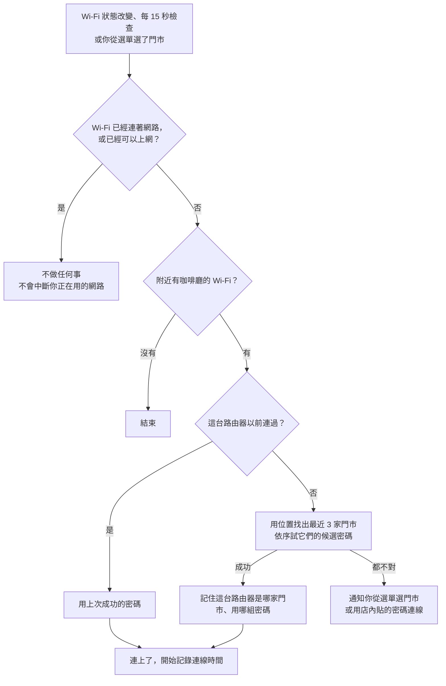

# CafeWiFi

走進路易莎（以及之後支援的其他咖啡廳），Windows 自動連上 Wi-Fi。
不用問密碼，也不用一直「忘記這個網路」。

## 為什麼需要它？

每一家路易莎的 Wi-Fi 都叫 `LouisaCoffee`，但每家的密碼都不一樣（是那家店的電話號碼）。Windows 一個網路名稱只會記住一組密碼，所以換一家店就連不上，得先「忘記」再重新輸入密碼。

CafeWiFi 會認出你在哪一家店，自動換上那家店的密碼。全台 500 多家路易莎門市的資料都已經內建。

## 它能做什麼

- ☕ **自動連線**：到了店裡，打開電腦就會自動連上。
- 📍 **認得每一家店**：用位置找出最近的門市；連過一次的店，下次一兩秒就連上。
- 🔎 **手動選店**：沒有自動連上時，從系統匣的 ☕ 點一下門市就好，也可以依縣市找。
- 🔑 **用密碼連線**：店裡都貼著 Wi-Fi 密碼，直接點那一組或自己輸入。
- 📊 **連線統計**：像 GitHub 的方格圖一樣，看你每天在咖啡廳待多久、最常去哪幾家、每個月去幾次。
- 🔄 **自動更新**：有新版本或新門市時會通知你，從選單點一下就更新好。
- 🔒 **資料只在你的電腦上**：不需要帳號，不會上傳任何資料。

## 安裝

需要 Windows 10（2004 以上）或 Windows 11，64 位元。

1. 到 [Releases](../../releases/latest) 下載 `CafeWiFi-win-x64.zip`，解壓縮出 `CafeWiFi.exe`，放到你想放的資料夾（例如 `文件\CafeWiFi`）。不用安裝任何執行環境。
2. 點兩下 `CafeWiFi.exe`。第一次執行時，Windows 可能會顯示「Windows 已保護您的電腦」：這是因為程式沒有付費做程式碼簽章，不是病毒。按「**其他資訊**」→「**仍要執行**」即可。
3. **允許定位**：Windows 11 規定 App 要有「位置」權限，才能讀取 Wi-Fi 名稱和路由器資訊。如果跳出通知，點它打開設定；或自己到「設定 → 隱私權與安全性 → 位置」，打開「位置服務」和「**讓桌面應用程式存取您的位置**」。
4. ☕ 會出現在右下角的系統匣。Windows 11 預設會把新圖示收進「^」裡面，可以把它拖到工作列上。建議從選單勾選「**開機時啟動**」。

## 怎麼用

**什麼都不用做。** 到了店裡就會自動連上，連上時會跳出通知，例如「已連上：延平門市」。

點 ☕（左鍵或右鍵都可以）可以：

- 看現在連到哪一家
- 「用密碼連線」：直接選最近那家店張貼的那組密碼，或選「輸入密碼…」
- 「附近門市」：點一下門市，自動嘗試它的密碼
- 「所有門市」：依縣市找到門市，選「自動嘗試」或其中一組密碼
- 「連線統計…」（也可以直接點兩下 ☕）
- 開關「自動連線」「只顯示連過的門市」「開機時啟動」
- 「不在系統匣顯示…」把 ☕ 藏起來（程式仍會在背景自動連線）；再打開一次 `CafeWiFi.exe` 就會出現
- 檢查更新

## 它是怎麼運作的



重點在「記住路由器」：同一家店只要成功連過一次，之後不管定位準不準，看到那台路由器就直接用對的密碼。

## 常見問題

<details>
<summary>為什麼需要定位權限？</summary>

兩個原因：用你的位置找出最近的門市；另外，Windows 11 規定 App 要有位置權限才能讀取 Wi-Fi 名稱和路由器資訊。位置只在你的電腦上使用，不會傳到任何地方。
</details>

<details>
<summary>到了店裡但沒有自動連上？</summary>

點 ☕，從「附近門市」點你所在的那一家，或從「所有門市」找到它再選「自動嘗試」。選過一次之後，下次到這家店就會自動連上。

筆電沒有 GPS，沒有網路時位置可能不準，所以第一次去某家店偶爾需要手動選一次。如果都不對，看一下店內張貼的 Wi-Fi 密碼，從「用密碼連線」點那一組，或選「輸入密碼…」。
</details>

<details>
<summary>會不會打斷我正在用的網路？</summary>

不會。只要 Wi-Fi 已經連著別的網路，或你已經可以上網（例如插著網路線），程式就不會去切換 Wi-Fi。
</details>

<details>
<summary>程式會改到我的 Wi-Fi 設定嗎？</summary>

會，但只限咖啡廳的網路：每試一組密碼，程式會覆寫那個網路名稱（例如 `LouisaCoffee`）的 Windows Wi-Fi 設定檔，並設成「不要自動連線」，由程式決定什麼時候連、用哪組密碼。其他網路完全不會動到。
</details>

<details>
<summary>怎麼移除？</summary>

1. 點 ☕ → 結束（如果 ☕ 被藏起來了，先再打開一次 `CafeWiFi.exe`）。如果勾過「開機時啟動」，結束前先取消勾選。
2. 刪除 `CafeWiFi.exe`。
3. （選擇性）刪除紀錄：在檔案總管網址列輸入 `%APPDATA%\CafeWiFi` 和 `%LOCALAPPDATA%\CafeWiFi`，刪掉這兩個資料夾。
</details>

---

## 進階

### 命令列

```
CafeWiFi.exe --connect 延平            連到名稱或地址符合的門市（多個關鍵字用空白分開）
CafeWiFi.exe --connect 延平 --brand louisa
CafeWiFi.exe --nearest                 連到最近的門市
CafeWiFi.exe --stats                   打開連線統計
CafeWiFi.exe --update                  檢查或安裝更新
```

程式已經在執行時，這些指令會交給執行中的那一份處理。`--connect` 符合多家門市時，會列出它們並以結束碼 2 結束（找不到則為 3）。每次狀態改變都會寫到 `%APPDATA%\CafeWiFi\status.json`（`state`、`message`、`time`），方便腳本或 Raycast／PowerToys Run 之類的工具讀取。

### 新增咖啡廳品牌

每個品牌就是一份 JSON，程式本身不需要修改：

1. 寫一支 `scripts/brands/<id>.py`，產生 `data/brands/<id>.json`：

   ```json
   {
     "id": "louisa",
     "name": "路易莎咖啡",
     "ssids": ["LouisaCoffee"],
     "stores": [
       { "name": "延平門市", "address": "台北市 中正區 ...", "city": "台北市", "phone": "02-2361-0718",
         "lat": 25.04, "lng": 121.51, "passwords": ["23610718", "0223610718", "223610718"] }
     ]
   }
   ```

   `passwords` 依可能性排序，程式會依序嘗試（每組錯的密碼大約要 15 秒才會失敗，所以最好不要超過 3 組）。沒有座標的門市，`lat`、`lng` 填 0。
2. 重新編譯，新品牌就會內建在 exe 裡。每週的 GitHub Actions 會自動執行 `scripts/brands/` 裡所有的腳本。

不想重新編譯的話，也可以把 JSON 放進 `%APPDATA%\CafeWiFi\brands\`。和內建品牌 `id` 相同的檔案會取代內建資料，新的 `id` 則會新增一個品牌。

目前只支援「每家店一組密碼」的 WPA2-Personal 網路；需要網頁登入的開放網路（captive portal）還不支援。

### 路易莎的密碼規則

路易莎的 Wi-Fi 密碼是門市的電話號碼，但寫法不統一，所以從電話產生 2 到 3 組候選密碼：

| 電話 | 依序嘗試 |
|---|---|
| 02-2361-0718 | `23610718` → `0223610718` → `223610718` |
| 04-2326-2617 | `423262617` → `0423262617` → `23262617` |
| 03-338-0980 | `33380980` → `033380980` |

門市資料由 [`scripts/brands/louisa.py`](scripts/brands/louisa.py) 從[路易莎官網的門市查詢](https://www.louisacoffee.co/visit)抓取。

### 自己編譯

需要 [.NET 8 SDK](https://dotnet.microsoft.com/download/dotnet/8.0)：

```powershell
./build.ps1                    # 跑測試，產生 build/publish/CafeWiFi.exe 和 build/CafeWiFi-win-x64.zip
dotnet run --project src/CafeWiFi
```

推送 `v*` 標籤到 GitHub 後，GitHub Actions 會編譯並發布 Release；自動更新只在 CI 編出來的版本裡啟用。

### 隱私

連線與使用紀錄都存在你的電腦上：連過的路由器與密碼存在 `%APPDATA%\CafeWiFi\learned.json`，時間紀錄存在同一個資料夾的 `usage.json`。程式只會連到 `www.msftconnecttest.com`（確認網路是否可用，和 Windows 自己用的一樣）和 GitHub（檢查及下載更新）。

## 授權

MIT，見 [LICENSE](LICENSE)。
